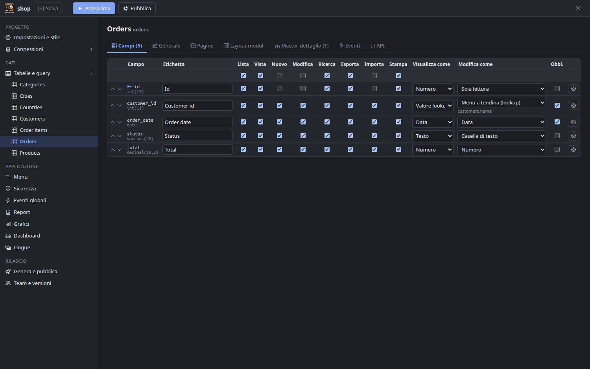
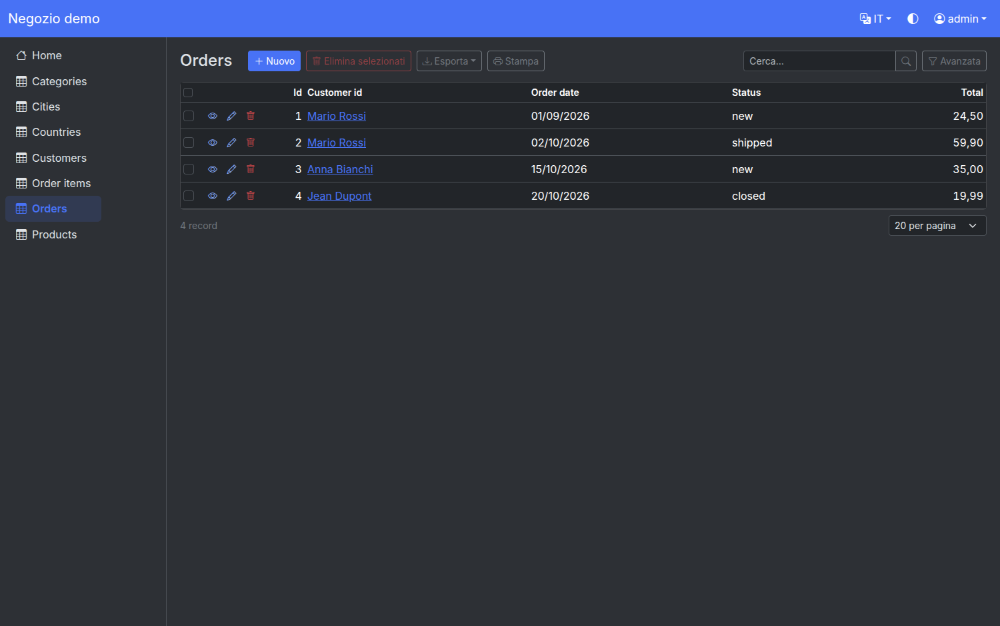

# MiB-Crude

Generatore visuale di applicazioni web PHP per Linux, per Linux, con lavoro **multisviluppatore** nativo. Progetto educativo.



## Cosa fa

Parti da un database esistente (MariaDB/MySQL, PostgreSQL, SQL Server, Oracle, SQLite) o da un **servizio REST JSON**, scegli le tabelle — oppure crea tabelle e dati da un **modello pronto** (CRM, helpdesk, prenotazioni risorse, archivio documenti) — e ottieni un'applicazione web completa:

- **Pagine**: lista (ricerca rapida, ricerca avanzata, pannello filtri, ordinamento, paginazione, totali, selezione multipla), nuovo, modifica, visualizza, copia, elimina, stampa, esporta (CSV/XLSX/JSON), importa (CSV/XLSX con aggiornamento e "tutto o niente")
- **Campi**: 17 formati di visualizzazione e 19 controlli di modifica — lookup da tabella o elenco fisso, a cascata, completamento automatico, selezione multipla, "aggiungi nuovo" in finestra; upload file/immagini con miniature e ridimensionamento (cartella o BLOB); testo formattato; validazioni (obbligatorio, unico, email, min/max, regex)
- **Master-dettaglio** ricavato dalle chiavi esterne (schede nella vista/modifica, icone nella lista)
- **Viste della lista**: calendario, kanban, galleria, mappa; modifica in linea; nuovo/modifica in finestra; campi QR code e firma
- **Page designer** a sezioni (riquadri o schede, colonne, larghezze per campo) con blocchi HTML e snippet PHP
- **Eventi PHP** (BeforeAdd, AfterEdit, BeforeSelect, CustomValidate…) con editor Monaco, controllo sintassi, azioni predefinite e **Assistente AI** (Claude: scrive o modifica l'evento conoscendo tabelle e campi del progetto, controlla la sintassi con `php -l`; chiave API cifrata nel portachiavi di sistema)
- **Origini dati REST**: una risorsa di un'API JSON (autenticazione Bearer, Basic, chiave in header o URL) diventa una tabella con lista, ricerca, filtri, ordinamento, totali, visualizza/modifica/elimina tramite l'API; paginazione lato API (pagina o scostamento, ricerca e ordinamento delegati), lookup verso risorse REST, report e grafici
- **Sicurezza**: utenti gestiti o tabella esistente o utente fisso, gruppi, permessi per tabella (A/E/D/S/V/P/I), **permessi dinamici** gestibili dall'app, record per utente, registrazione con conferma email, recupero password, CAPTCHA, regole password, blocco dopo tentativi falliti, **LDAP/Active Directory**, **OpenID Connect** (Okta, Entra ID, Google, Keycloak) con mappatura gruppi, **SAML 2.0** (firma XML verificata), **autenticazione a due fattori** (TOTP)
- **Registro attività** (audit) e **blocco record** durante la modifica
- **Report** con raggruppamenti e totali, **grafici** (Apache ECharts), **dashboard**; **Report & Chart Builder** web per gli utenti finali
- **API REST** per tabella con chiave API e descrizione **OpenAPI**
- Menu ad albero, temi (colore, barra laterale/alta, chiaro/scuro), **multilingua** con traduzioni
- **Anteprima** integrata (PHP locale o Docker) e **pubblicazione** incrementale via SFTP, FTP/FTPS o cartella



## Importazione di progetti .phpr

Pulsante **Importa progetto .phpr** nella schermata iniziale: legge il file `.phpr` (phpr 10.x) e l'archivio pagine `PAGES*.sqlite` accanto, e converte connessioni (password solo in locale), tabelle, query SQL, campi, lookup (anche a cascata), pagine e campi per pagina, master-dettaglio, menu, gruppi e permessi, grafici ed eventi PHP. Gli eventi funzionano senza riscriverli grazie allo strato di compatibilità del runtime (`DB::Query`, `DB::Lookup`, `Security::getUserName()`, `$pageObject`, `$xt`, `$record` in BeforeMoveNext, `runner_mail`…). Il codice PHP 7.4 viene adeguato a PHP 8 (correzioni automatiche sicure, il resto segnalato in `import-phpr/REPORT.md`). Anche eventi JavaScript (`pageObj`, `Runner.getControl`), pulsanti personalizzati (OnBefore/OnServer/OnAfter), varianti di pagina, dashboard e personalizzazioni AnyChart dei grafici (`JS_ModifyChart`, tradotte su ECharts) vengono convertiti.

## Liste e grafici

Le liste usano **DataTables 2 in modalità server-side** (ordinamento, ricerca e paginazione in SQL, colonne visibili, stato ricordato, totali), sempre con scroll orizzontale e verticale e intestazione fissa. Anche report, amministrazione, stampa e le altre pagine scorrono in entrambe le direzioni. I grafici usano **Apache ECharts** (colonne, barre, linee, aree, dispersione, torta, ciambella, rosa, imbuto, treemap, gauge, radar; esportazione immagine, vista dati, cambio tipo).

## Temi grafici da template acquistati

In *Impostazioni e stile → Temi grafici → Importa template…* si indica la cartella dei template (es. ThemeForest). MiB-Crude riconosce i template Bootstrap 5 per cui ha un adattatore — **Metronic 8** (Keenthemes) e **Cork 3 / Equation 2** (DesignReset), con tutte le varianti di menu verticali e orizzontali, e **Satria** per le pagine di accesso e la pagina di presentazione pubblica; anche i template Bootstrap 4/3 **Slim** (menu laterale o orizzontale, skin scura legata alla modalità scura dell'app) e **Webarch** (colori Predefinito, Corporate, Elegant, Simple), dei quali si tiene solo lo stile del tema senza il vecchio Bootstrap — e copia solo CSS/JS/font nella libreria locale `~/.config/MiB-Crude/themes`. Il layout dell'app generata usa il markup originale del template (menu laterale, intestazione, modalità scura); liste DataTables, moduli e grafici ECharts prendono lo stile del tema. I file dei template non entrano mai nel codice di MiB-Crude né nel progetto (licenze). Template AngularJS o senza adattatore vengono segnalati come non compatibili.

## Multisviluppatore

Due modalità, usabili insieme:

1. **Git** — il progetto è una cartella di piccoli file JSON/PHP ordinati in modo deterministico (`tables/ordini.json`, `events/ordini/BeforeAdd.php`, …): diff leggibili, merge puliti, branch. Il pannello *Team e versioni* fa commit, pull, push, diff e risoluzione conflitti.
2. **Server del team** (tempo reale, come phpr MultiDev ma a grana più fine) — chi apre una tabella, il menu, la sicurezza o gli eventi globali li **blocca** per gli altri; ogni salvataggio arriva subito agli altri designer; presenza online, chat, rilevamento conflitti a tre vie, storico Git sul server.

```bash
npm run server -- --data ./team-data                       # avvia il server (ws://0.0.0.0:7300)
node server/mibcrude-server.cjs --data ./team-data --add-user mario --role admin   # crea utente, stampa il token
```

Password di database, chiavi e destinazioni di pubblicazione restano in `.mibcrude-local/` sul computer di ciascuno sviluppatore, mai nel progetto condiviso.

## Avvio

```bash
npm install
npm run dev        # designer in sviluppo
npm start          # build + avvio
npm test           # test end-to-end (MariaDB demo + server del team)
npm run dist       # AppImage e .deb
```

L'app controlla gli aggiornamenti sulle release GitHub all'avvio (al massimo ogni 12 ore, disattivabile): l'AppImage si sostituisce da sola, il `.deb` si installa con `pkexec apt`.

Esportazione/importazione di tabelle tra progetti in ZIP (impostazioni, report, grafici ed eventi come file leggibili). I test end-to-end richiedono MariaDB con l'utente `mibcrude`/`mibcrude` sul database `mibcrude_demo` (schema in `tests/fixtures/demo-mysql.sql`) e `php-cli` con `pdo_mysql`.

## Architettura

| Cartella | Contenuto |
|---|---|
| `core/` | modello di progetto su file, introspezione dei 5 database, default del wizard, generatore, protocollo team |
| `runtime/` | runtime PHP dell'app generata (PHP 7.4 – 8.5, testato su 7.4, 8.4, 8.5): PDO multi-dialetto, pagine, sicurezza, API, report, compatibilità phpr |
| `electron/` | processo principale del designer: IPC, anteprima, pubblicazione, Git, client del server del team |
| `src/` | interfaccia del designer (React + Monaco) |
| `server/` | server del team (WebSocket) |

L'app generata è il runtime fisso più la configurazione del progetto (`config/*.php`) e gli eventi: rigenerare non perde mai codice scritto a mano, perché vive nel progetto (`events/`, `custom/`).
