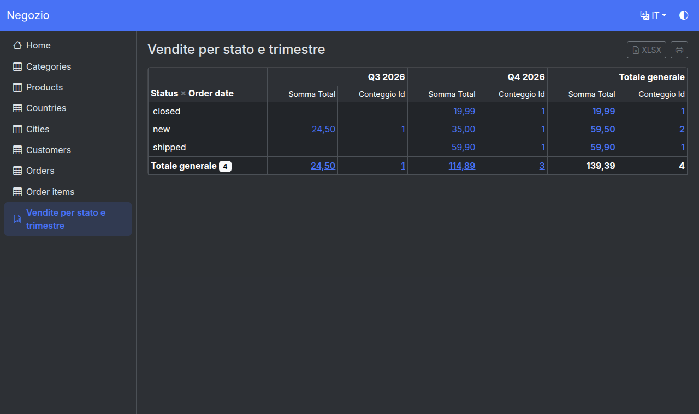
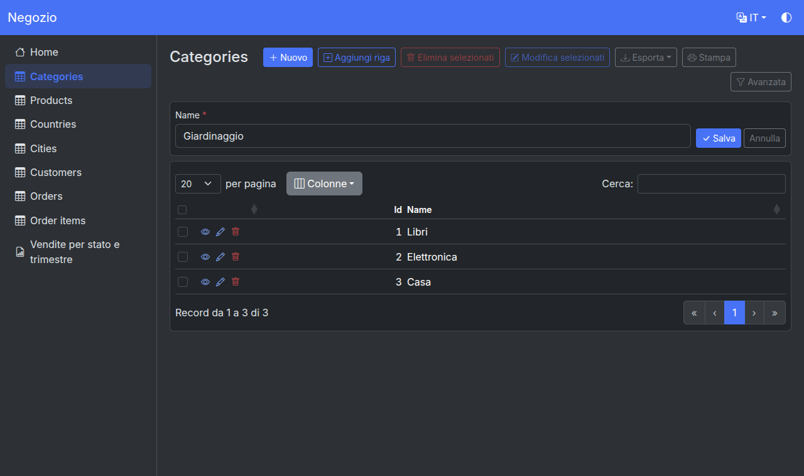
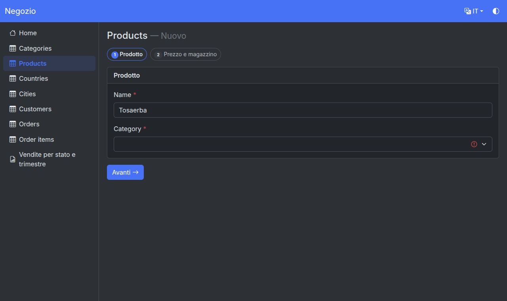
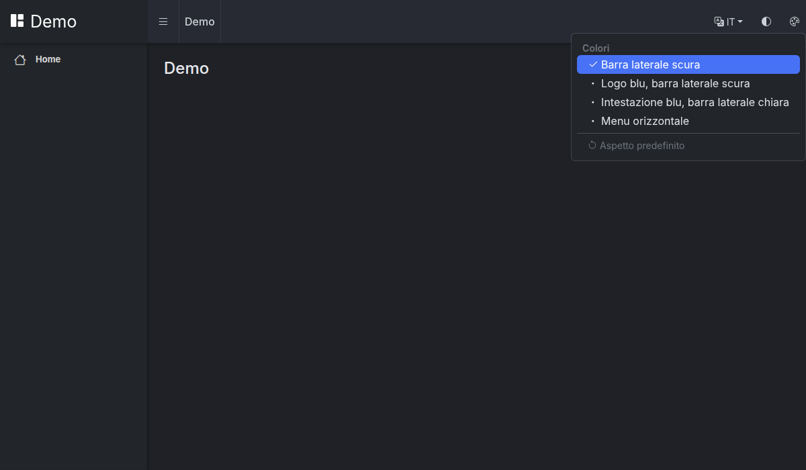
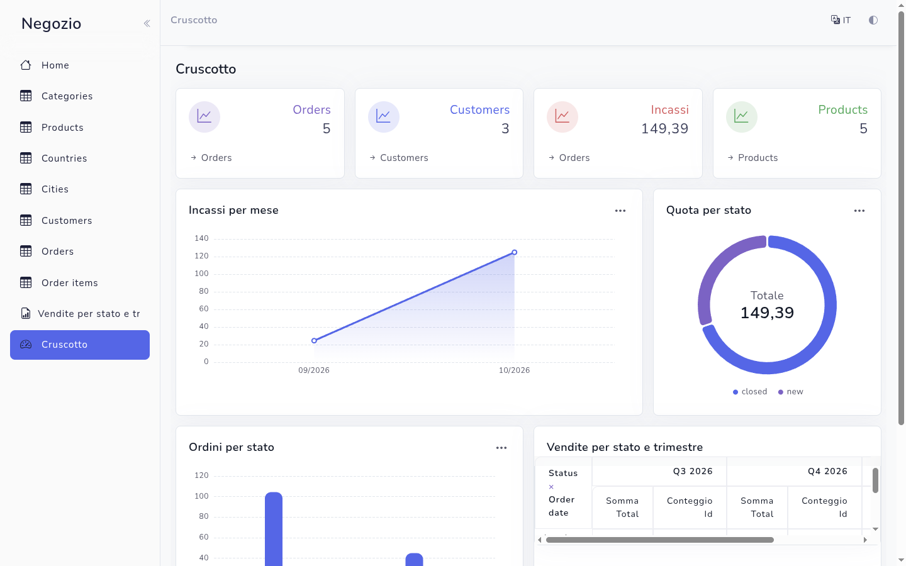
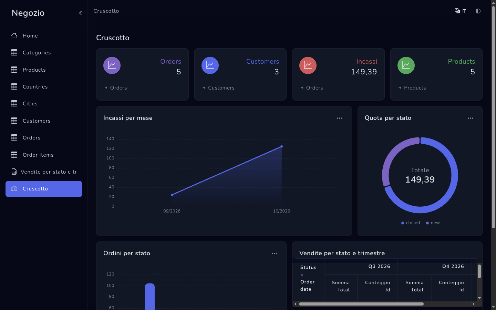
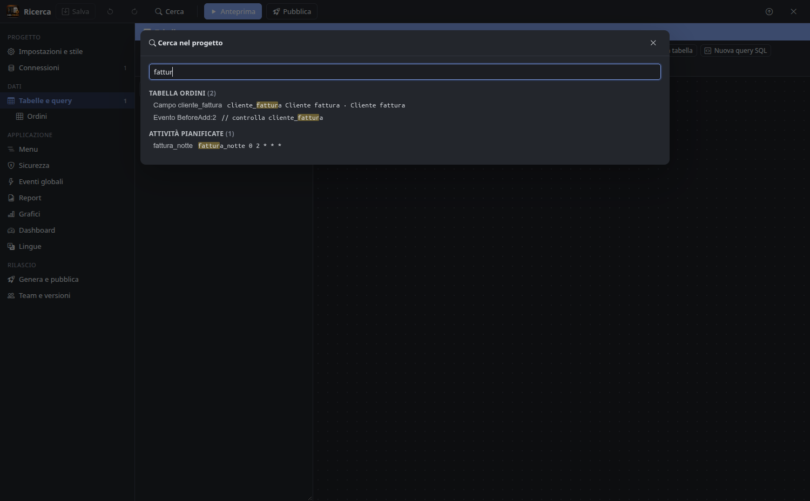
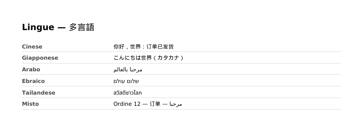

# MiB-Crude

Generatore visuale di applicazioni web PHP per Linux, per Linux, con lavoro **multisviluppatore** nativo. Progetto educativo.


## Cosa fa

Parti da un database esistente (**MariaDB/MySQL, PostgreSQL, SQL Server, Oracle, SQLite**), da un **servizio REST JSON** o da una **stored procedure**, oppure crea tabelle e dati da un **modello pronto** (CRM, helpdesk, prenotazioni, archivio documenti). MiB-Crude genera un'applicazione web PHP completa (PHP 7.4 – 8.5), la mostra in anteprima e la pubblica.

Documentazione completa:

- **[Guida](docs/GUIDA.md)**: ogni funzione del designer e dell'applicazione, e dove si trova
- **[Riferimento tecnico](docs/RIFERIMENTO.md)**: eventi, funzioni PHP, compatibilità phpr, tabelle di sistema, formato del progetto
- **[L'applicazione generata](docs/APP-GENERATA.md)**: struttura, requisiti del server, pubblicazione, Docker, attività pianificate, API
- [Test](docs/TESTING.md) · [Versioni e limiti noti](docs/ROADMAP.md)

### Dati

- **Origini dati**: tabelle, query SQL (anche modificabili), risorse **REST** (paginazione e filtri nella sintassi dell'API: `?campo=valore`, json-server, Strapi o personalizzata; cache), **stored procedure** (parametri da valori, sessione, utente o indirizzo; scrittura tramite procedure di inserimento, modifica ed eliminazione; filtri)
- **Campi**: 17 formati di visualizzazione e 19 controlli di modifica; lookup da tabella o elenco, a cascata, completamento automatico, selezione multipla, «aggiungi nuovo»; file e immagini (cartella o BLOB, miniature); testo formattato; QR code; firma; validazioni; **campi cifrati** nel database (AES-256)
- **Master-dettaglio** dalle chiavi esterne; creazione e modifica di tabelle; script SQL in ogni dialetto; sincronizzazione con il database

### Pagine

- **Lista**: ricerca rapida e avanzata, pannello filtri, **ricerche salvate**, ordinamento, totali, colonne visibili, **modifica e aggiunta in linea**, **modifica selezionati**, viste **calendario, kanban, galleria, mappa** (con **geocodifica** degli indirizzi)
- **Nuovo / modifica / visualizza**: designer delle pagine a sezioni (riquadri, schede o **passi** con Avanti/Indietro), blocchi HTML e PHP, finestre popup, copia, blocco del record durante la modifica
- **Esportazione** CSV, XLSX, JSON e **PDF** in quasi tutte le lingue (anche cinese, giapponese, arabo, ebraico, tailandese) con le immagini dei campi; **stampa**; **importazione** CSV/XLSX
- **Report** con raggruppamenti e totali, report **a campi incrociati (crosstab)**; **grafici** Apache ECharts con clic che apre la lista filtrata; **dashboard**; **Report & Chart Builder** per gli utenti
- **API REST** per tabella con chiave API e descrizione **OpenAPI**

### Utenti e sicurezza

- Utenti gestiti dall'app, tabella utenti esistente, utente fisso o **accesso Windows (NTLM)** come nei progetti R-LAB
- Gruppi e permessi per tabella (anche gestibili dall'app), record per utente, ospiti, registrazione con conferma email, recupero password, CAPTCHA, regole password, blocco dopo tentativi falliti, **«Ricordami»**
- **Verifica in due passaggi** con app di autenticazione o **codice via email o SMS**
- **LDAP / Active Directory**, **OpenID Connect**, **SAML 2.0**
- **Accedi come** un altro utente per l'amministratore, **registro attività**, **notifiche**

### Automazione e comunicazione

- **Eventi PHP** e JavaScript con editor Monaco e **assistente AI** (Claude)
- **Attività pianificate** (cron) con esito in amministrazione
- **Modelli email** per lingua, **SMS** (Twilio o qualunque gateway HTTP)

### Aspetto

- Colori, menu laterale o in alto, chiaro/scuro, multilingua
- **Temi grafici da template acquistati** (Metronic 8, Cork/Equation, Satria, Slim, Webarch, Material Admin), con **aspetto scelto dall'utente** per Material, Webarch e Slim; con **Equation** cruscotti, grafici, home, liste e accesso prendono lo stile del template, chiaro e scuro
- Intestazione, piè di pagina e menu del progetto (file o codice)
- **App installabile (PWA)** su telefoni e computer

### Designer

- **Annulla/ripeti**, **cerca nel progetto**, anteprima integrata (PHP locale o Docker)
- Pubblicazione incrementale via SFTP, FTP/FTPS o cartella
- **Docker di progetto** che replica la produzione (Linux, o Windows Server Core con l'Apache24 di produzione)
- **Multisviluppatore**: Git o server del team in tempo reale
- **Importazione di progetti .phpr** con strato di compatibilità per gli eventi


| | |
|---|---|
|  Report a campi incrociati |  Aggiunta in linea |
|  Pagina Nuovo a passi |  Aspetto scelto dall'utente (Material Admin) |
|  Cruscotto con il tema Equation |  Lo stesso in modalità scura |
|  Cerca nel progetto |  PDF in più scritture |

## Importazione di progetti .phpr

Pulsante **Importa progetto .phpr** nella schermata iniziale: legge il file `.phpr` (phpr 10.x) e l'archivio pagine `PAGES*.sqlite` accanto, e converte connessioni (password solo in locale), tabelle, query SQL, campi, lookup (anche a cascata), pagine e campi per pagina, master-dettaglio, menu, gruppi e permessi, grafici ed eventi PHP. Gli eventi funzionano senza riscriverli grazie allo strato di compatibilità del runtime (`DB::Query`, `DB::Lookup`, `Security::getUserName()`, `$pageObject`, `$xt`, `$record` in BeforeMoveNext, `runner_mail`…). Il codice PHP 7.4 viene adeguato a PHP 8 (correzioni automatiche sicure, il resto segnalato in `import-phpr/REPORT.md`). Anche eventi JavaScript (`pageObj`, `Runner.getControl`), pulsanti personalizzati (OnBefore/OnServer/OnAfter), varianti di pagina, dashboard e personalizzazioni AnyChart dei grafici (`JS_ModifyChart`, tradotte su ECharts) vengono convertiti.

## Liste e grafici

Le liste usano **DataTables 2 in modalità server-side** (ordinamento, ricerca e paginazione in SQL, colonne visibili, stato ricordato, totali), sempre con scroll orizzontale e verticale e intestazione fissa. Anche report, amministrazione, stampa e le altre pagine scorrono in entrambe le direzioni. I grafici usano **Apache ECharts** (colonne, barre, linee, aree, dispersione, torta, ciambella, rosa, imbuto, treemap, gauge, radar; esportazione immagine, vista dati, cambio tipo).

## Temi grafici da template acquistati

In *Impostazioni e stile → Temi grafici → Importa template…* si indica la cartella dei template (es. ThemeForest). MiB-Crude riconosce i template Bootstrap 5 per cui ha un adattatore — **Metronic 8** (Keenthemes) e **Cork 3 / Equation 2** (DesignReset), con tutte le varianti di menu verticali e orizzontali, e **Satria** per le pagine di accesso e la pagina di presentazione pubblica; anche i template Bootstrap 4/3 **Slim** (menu laterale o orizzontale, skin scura legata alla modalità scura dell'app) e **Webarch** (colori Predefinito, Corporate, Elegant, Simple, con skin scura aggiunta da MiB-Crude), dei quali si tiene solo lo stile del tema senza il vecchio Bootstrap, e **Material Design Admin** (AngularJS: intestazione e menu riscritti senza AngularJS, quattro combinazioni di colori anche con menu orizzontale, skin scura aggiunta) — e copia solo CSS/JS/font nella libreria locale `~/.config/MiB-Crude/themes`. Il layout dell'app generata usa il markup originale del template (menu laterale, intestazione, modalità scura); liste DataTables, moduli e grafici ECharts prendono lo stile del tema. I file dei template non entrano mai nel codice di MiB-Crude né nel progetto (licenze). Template senza adattatore vengono segnalati come non compatibili.

## Multisviluppatore

Due modalità, usabili insieme:

1. **Git** — il progetto è una cartella di piccoli file JSON/PHP ordinati in modo deterministico (`tables/ordini.json`, `events/ordini/BeforeAdd.php`, …): diff leggibili, merge puliti, branch. Il pannello *Team e versioni* fa commit, pull, push, diff e risoluzione conflitti.
2. **Server del team** (tempo reale, come phpr MultiDev ma a grana più fine) — chi apre una tabella, il menu, la sicurezza o gli eventi globali li **blocca** per gli altri; ogni salvataggio arriva subito agli altri designer; presenza online, chat, rilevamento conflitti a tre vie, storico Git sul server.

```bash
npm run server -- --data ./team-data                       # avvia il server (ws://0.0.0.0:7300)
node server/mibcrude-server.cjs --data ./team-data --add-user mario --role admin   # crea utente, stampa il token
```

Password di database, chiavi e destinazioni di pubblicazione restano in `.mibcrude-local/` sul computer di ciascuno sviluppatore, mai nel progetto condiviso.

## Avvio

```bash
npm install
npm run dev        # designer in sviluppo
npm start          # build + avvio
npm test           # test end-to-end (MariaDB demo + server del team)
npm run dist       # AppImage e .deb
```

L'app controlla gli aggiornamenti sulle release GitHub all'avvio (al massimo ogni 12 ore, disattivabile): l'AppImage si sostituisce da sola, il `.deb` si installa con `pkexec apt`.

Esportazione/importazione di tabelle tra progetti in ZIP (impostazioni, report, grafici ed eventi come file leggibili). I test end-to-end richiedono MariaDB con l'utente `mibcrude`/`mibcrude` sul database `mibcrude_demo` (schema in `tests/fixtures/demo-mysql.sql`) e `php-cli` con `pdo_mysql`.

## Architettura

| Cartella | Contenuto |
|---|---|
| `core/` | modello di progetto su file, introspezione dei 5 database, default del wizard, generatore, protocollo team |
| `runtime/` | runtime PHP dell'app generata (PHP 7.4 – 8.5, testato su 7.4, 8.4, 8.5): PDO multi-dialetto, pagine, sicurezza, API, report, compatibilità phpr |
| `electron/` | processo principale del designer: IPC, anteprima, pubblicazione, Git, client del server del team |
| `src/` | interfaccia del designer (React + Monaco) |
| `server/` | server del team (WebSocket) |

L'app generata è il runtime fisso più la configurazione del progetto (`config/*.php`) e gli eventi: rigenerare non perde mai codice scritto a mano, perché vive nel progetto (`events/`, `custom/`).
